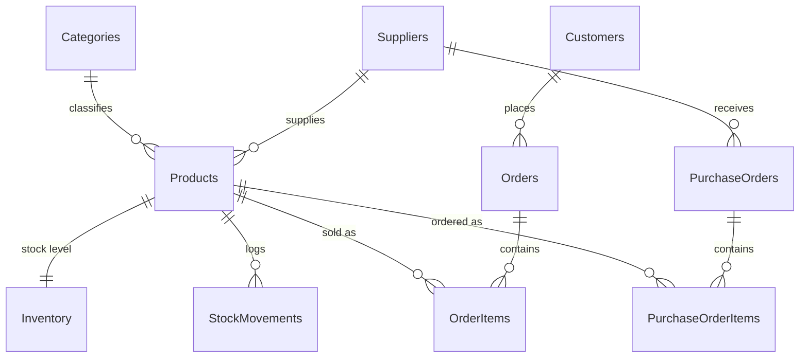
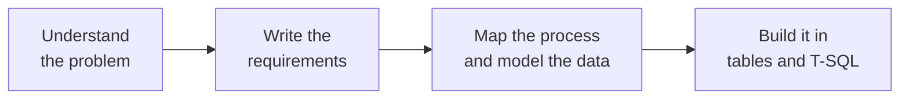

<h1 align="center">Rabogale Matjokotja</h1>

<p align="center">
  <b>Aspiring Database Administrator &amp; Systems Analyst</b><br>
  3rd-year Informatics student · Tshwane University of Technology · South Africa
</p>

<p align="center">
  <a href="https://rabogale-matjokotja.github.io"></a>
  <a href="mailto:rabomatjuks@gmail.com"></a>
  <a href="https://www.instagram.com/rabo.exe"></a>
  <a href="https://x.com/rabogale_"></a>
  <a href="https://www.facebook.com/rabo.hq"></a>
</p>

---

```sql
SELECT name, role, year
FROM   rabogale
WHERE  learning = 1;
```

```text
name   Rabogale Matjokotja
role   Aspiring DBA & Systems Analyst
year   3rd year, Informatics at TUT
(1 row)
```

I'm early in my career and I learn by building. I pick a real-world problem, design the database for it, write the T-SQL myself and publish the result, including what I'm still figuring out.

---

## 📌 Featured project

### [RetailStock: Inventory & Sales Database](https://github.com/rabogale-matjokotja/retailstock)

> **The problem:** a small retailer needs to know what to reorder and what isn't selling.

An **MS SQL Server** database that answers those questions.

- A relational schema of 10 tables with keys and constraints, plus seed data
- T-SQL queries and views that flag products to reorder and find slow-moving stock
- A static dashboard published with GitHub Pages

**[→ Live dashboard](https://rabogale-matjokotja.github.io/retailstock/)** · **[→ Code](https://github.com/rabogale-matjokotja/retailstock)**

<details>
<summary><b>View the data model</b></summary>



</details>

## 🔨 In progress

**Community Library & Book Lending System** (T-SQL): a database for members, books, loans and returns, designed from the ERD up and coded by me.

---

## 🧭 How I build



## 🛠️ Skills


| Area | What I can do so far |
|---|---|
| SQL / T-SQL | Joins, views for reporting and indexes to speed up queries |
| Database design | Tables with keys and constraints that keep data valid |
| Java | Classes and objects using core OOP principles |
| System analysis | Requirements, process flows and data modelling |

## 🎯 Next steps

- [ ] T-SQL query tuning and reading execution plans
- [ ] Backup, recovery and security basics for database administration
- [ ] Documenting systems with UML and process diagrams

---

<p align="center">
  <i>Want to talk databases or give feedback on a project?</i><br>
  <a href="mailto:rabomatjuks@gmail.com">rabomatjuks@gmail.com</a>
</p>
